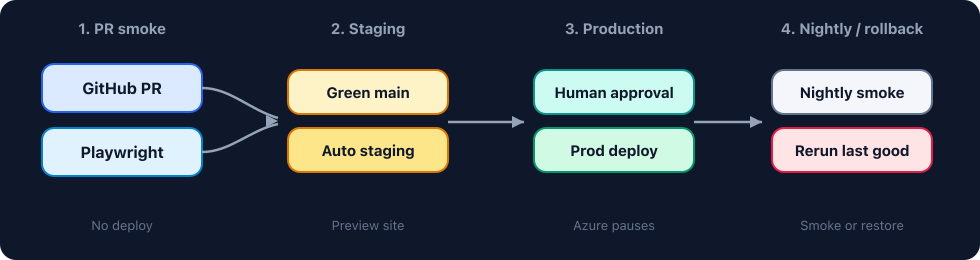

# ☁️ Azure Release Lab

A **tiny web board** plus an **Azure Pipelines path**: PR smoke, auto staging, production approval, nightly smoke, and rollback.

**Live demo:** coming after the first Vercel + Azure connect.

## How the flow works



| Step | Color | What it is |
|------|-------|------------|
| **1 · PR smoke** | Blue | Build + Playwright. No deploy. |
| **2 · Staging** | Amber | Green `main` deploys a preview automatically. |
| **3 · Production** | Teal | Azure pauses until a person approves, then ships. |
| **4 · Nightly / rollback** | Gray / rose | Scheduled smoke with no deploy, or rerun last good production. |

## Why this exists

[Release Gate Lab](https://github.com/ramonacraft/release-gate-lab) answers **did smoke pass**. This lab answers **where a change is on the path**.

The site is small on purpose. Azure is the product. The page is proof of which lane deployed it (local, staging, or production).

## What’s on the board

1. **Release path** — which lane this site is on, with four stops
2. **How a change moves** — PR, staging, production approval, nightly
3. **Rollback** — rerun a green production stage; Azure still asks for approval
4. **Recent runs** — live Azure when configured; demo rows otherwise

## Quick start

**Prerequisites:** Node.js 20+

```bash
git clone https://github.com/ramonacraft/azure-release-lab.git
cd azure-release-lab
npm install
npm run dev
```

Open the URL Vite prints (usually `http://localhost:5173`).

You should see **Local path**, four Azure stops, and a Recent runs table (demo data until Azure is connected).

```bash
npm run build
npx playwright install chromium
npm run test:smoke
```

## Stack

| Layer | Choice |
|-------|--------|
| App | Vite + React + TypeScript |
| Smokes | Playwright (lean suite) |
| CI | Azure Pipelines (environments + approvals) |
| Host + API | Vercel (`/api/runs` proxies Azure) |

## Docs

| Doc | What |
|-----|------|
| [docs/AZURE_SETUP.md](docs/AZURE_SETUP.md) | Connect Azure, Vercel secrets, environments, walking the path |

## Pipeline behavior

```text
Pull request
  -> Build + Playwright
  -> Tests tab in Azure
  -> No deploy

main (CI)
  -> Build + Playwright
  -> Staging preview (auto)
  -> Production waits for approval
  -> Approve -> production deploy

Nightly schedule
  -> Build + Playwright
  -> No deploy

Red smoke
  -> Staging and production skipped

Rollback
  -> Rerun Deploy production on a previous green run
  -> Approve again
```

## What this intentionally skips

- No iOS / Android / CTV pipelines
- No 100+ test suite
- No cluster or container platform

## Related work

- [Release Gate Lab](https://github.com/ramonacraft/release-gate-lab) — lean Playwright gate and go/no-go dashboard
- This lab — the Azure path after the gate (staging, approval, nightly, rollback)

## Notes / Privacy

- **Published by** [Ramona Bonitatis](https://github.com/ramonacraft).
- **Default: no secrets.** The app and docs run with an empty or commented `.env`. `.env.example` has no real tokens.
- Azure PATs, Vercel tokens, and GitHub tokens belong only in host secret stores (Azure Pipeline secrets, Vercel env) — never the repo.
- Live demo may show Azure builds when those host secrets are configured; otherwise the board uses safe demo data.
